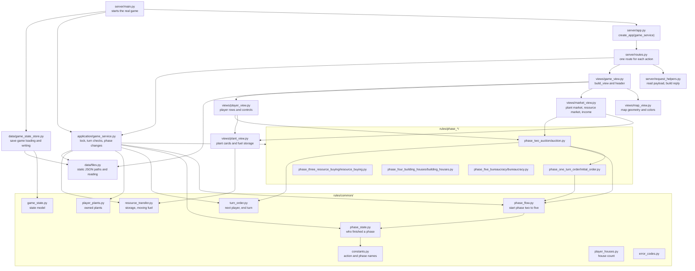

# Backend modules

Which backend Python module uses which. Rules never import from `server/`, `views/` or `application/`.

## Where a rule change goes

| You want to change | File |
| --- | --- |
| A rule of one phase | `rules/phase_*/` |
| Who starts a phase, which phase follows | `rules/common/phase_flow.py` and `GameService._start_next_phase` |
| What a button or label shows | `views/` and `game_info/static_info/power_grid_settings.json` |
| A new action name or phase name | `rules/common/constants.py` (and an `action_labels` entry in the settings) |
| A new URL | `server/routes.py` |

[Back to documentation](../index.md)
