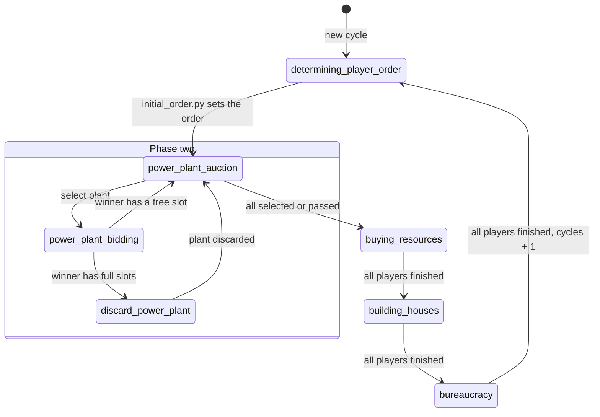

# Game phases

How `current_action` moves through one cycle. Phase two is ended by the auction rules; the other phases are ended by `GameService` when every player has finished.

[Back to documentation](../index.md)
